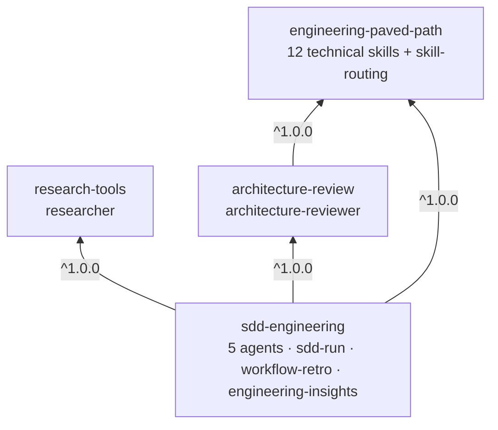
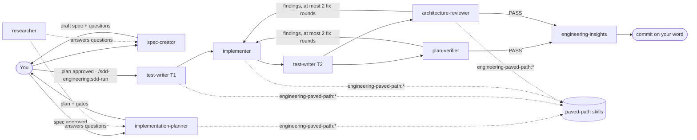

# Dev Digest AI marketplace

A [Claude Code plugin marketplace](https://code.claude.com/docs/en/plugins/create-marketplace) for spec-driven development: a multi-agent SDD harness, the shared paved-path engineering skills it builds on, an architecture reviewer and a researcher.

Browse and search it at **<https://kosyakovr.github.io/dev-digest-ai-marketplace/>**.

## Install

The marketplace has two release channels. Pick one:

| Channel | What you get | Add it with | Install as |
|---|---|---|---|
| **stable** | versions the owner has promoted after trying them in latest | `claude plugin marketplace add kosyakovr/dev-digest-ai-marketplace` | `<plugin>@dev-digest-ai` |
| **latest** | every new plugin and version as soon as it is merged | `claude plugin marketplace add kosyakovr/dev-digest-ai-marketplace#latest` | `<plugin>@dev-digest-ai-latest` |

```bash
# stable: add the marketplace once, then install the SDD harness; its three dependencies install with it
claude plugin marketplace add kosyakovr/dev-digest-ai-marketplace
claude plugin install sdd-engineering@dev-digest-ai
```

Inside a session, `/plugin` opens the same flow interactively.

- **Register one channel only.** With both, every plugin installs twice, once per marketplace. To move to the other one, see [Switch channels](#switch-channels).
- **Dependencies come from your channel.** A plugin's dependencies install from the same channel as the plugin.
- **Updates.** Auto-update is off by default for third-party marketplaces. Turn it on in `/plugin` → **Marketplaces**, or run `claude plugin marketplace update <marketplace>` and then `claude plugin update <plugin>@<marketplace>`. When an update adds a dependency, run `/reload-plugins` in a session to install it.

### Switch channels

Removing a marketplace also uninstalls every plugin installed from it, and deletes their saved options and data. Switching is therefore remove, add, install again. From stable to latest:

```bash
claude plugin marketplace remove dev-digest-ai
claude plugin marketplace add kosyakovr/dev-digest-ai-marketplace#latest
claude plugin install sdd-engineering@dev-digest-ai-latest
```

From latest to stable:

```bash
claude plugin marketplace remove dev-digest-ai-latest
claude plugin marketplace add kosyakovr/dev-digest-ai-marketplace
claude plugin install sdd-engineering@dev-digest-ai
```

Install every plugin you had, not only `sdd-engineering`; its dependencies come along with it. A running session keeps the plugins it loaded until `/reload-plugins` or the next start. For a team repository, see [Switch a team repository](#switch-a-team-repository).

How the channels work, and how a version gets promoted, is in [docs/RELEASES.md](docs/RELEASES.md).

## Plugins

<!-- catalog:start (generated by scripts/generate_catalog.py, do not edit) -->
| Plugin | Stable | Latest | Category | Description | Install |
|---|---|---|---|---|---|
| [architecture-review](plugins/architecture-review) | 1.1.0 | 1.1.0 | development | Architecture reviewer agent: checks a change against the repository's own architecture docs and the engineering-paved-path architecture skills, with verified rule-based findings. | `claude plugin install architecture-review@dev-digest-ai` |
| [engineering-paved-path](plugins/engineering-paved-path) | 1.1.0 | 1.1.0 | development | Shared technical skills for the paved path: React, testing, Next.js, Fastify, architecture, Drizzle, PostgreSQL, Zod, TypeScript, security and Mermaid, plus a map from files to skills. | `claude plugin install engineering-paved-path@dev-digest-ai` |
| [research-tools](plugins/research-tools) | 1.1.0 | 1.1.0 | research | Read-only researcher agent that answers one concrete question with evidence from the repository, official docs, changelogs and issues. | `claude plugin install research-tools@dev-digest-ai` |
| [sdd-engineering](plugins/sdd-engineering) | 1.3.0 | 1.3.0 | development | Spec-driven development harness: spec, plan, test, implementation and verification agents, an end-to-end /sdd-run orchestrator, run retrospectives and engineering insights. | `claude plugin install sdd-engineering@dev-digest-ai` |
<!-- catalog:end -->

## How the plugins work together

Four plugins, one workflow. `sdd-engineering` is the harness; the other three are its dependencies, and each also works on its own.



| Plugin | Provides | Depends on |
|---|---|---|
| [engineering-paved-path](plugins/engineering-paved-path) | Skills for React, testing, Next.js, Fastify, architecture, Drizzle, PostgreSQL, Zod, TypeScript, security and Mermaid, plus `skill-routing` (which skill governs which file) | — |
| [research-tools](plugins/research-tools) | `researcher`: read-only, evidence-backed answers from the repo and official docs | — |
| [architecture-review](plugins/architecture-review) | `architecture-reviewer`: boundary review against your architecture docs and the paved-path architecture skills | engineering-paved-path |
| [sdd-engineering](plugins/sdd-engineering) | `spec-creator`, `implementation-planner`, `test-writer`, `implementer`, `plan-verifier`; `/sdd-engineering:sdd-run`, `workflow-retro`, `engineering-insights` | all three |

### The flow



1. **Spec.** `sdd-engineering:spec-creator` turns your request and design files into a draft spec: EARS acceptance criteria, a source on every requirement, at most three open questions. You answer and approve it.
2. **Plan.** `sdd-engineering:implementation-planner` reviews the spec, finds what already exists, and writes work packages. Each one cites the `engineering-paved-path` sections that bind it (via `skill-routing`), the gates that need your approval, the project's real check commands, and a test brief split into T1 (before the code) and T2 (after). You approve it and choose multi-agent or single-agent.
3. **Run.** `/sdd-engineering:sdd-run <spec>` asks once, then runs test-writer T1 → implementer → test-writer T2 → plan-verifier and `architecture-review:architecture-reviewer` in parallel → at most two fix rounds on the delta → final verification → `engineering-insights`, and proposes a commit. It never pushes, and it resumes from the plan's Run log in a new chat.
4. **Learn.** `/sdd-engineering:workflow-retro` measures the run from its local transcripts and proposes at most five changes.

`research-tools:researcher` answers questions that need digging at any stage.

### Inputs instead of assumptions

No agent assumes a repository layout. The run resolves each input once — `--input name=value`, then an `## SDD` section in your `CLAUDE.md` or `AGENTS.md`, then a default — and hands it to every agent: `spec_dir` (`docs/specs/`), `plan_path` (`docs/plans/<spec>`), `check_commands` (the plan's Test plan), `protected_paths`, `architecture_docs`, `insights_files`, `run_dir` (inside `.git/`). Details: [sdd-engineering README](plugins/sdd-engineering/README.md#inputs).

### What runs on your machine

- No plugin ships hooks, MCP servers or credentials.
- Scripts run only when an agent or skill calls them: `spec-lint.sh` and `change-set.sh` (bash, read git state), `save-report.sh` (bash + python3, copies an agent's report from the local transcript), `retro.mjs` (node, reads `~/.claude/projects/<project>/` transcripts locally), `ts_diagnostic.py` (python3, runs your `tsc --noEmit`).
- Scope rules (who may write what, no commits, no lock files) live in each agent's tool list and prompt. Plugin agents cannot carry hook guards, so they are not a sandbox: review the diff before you commit.

## Use in a team repository

Commit this to the project's `.claude/settings.json`. It registers the marketplace for everyone who trusts the folder, turns on background auto-update for it (third-party marketplaces have it off by default), and enables the plugins:

```json
{
  "extraKnownMarketplaces": {
    "dev-digest-ai": {
      "source": { "source": "github", "repo": "kosyakovr/dev-digest-ai-marketplace" },
      "autoUpdate": true
    }
  },
  "enabledPlugins": {
    "sdd-engineering@dev-digest-ai": true
  }
}
```

Enabling `sdd-engineering` enables its three dependencies as well.

- **Each teammate installs once, in either channel.** After trusting the folder, each teammate runs `claude plugin install sdd-engineering@dev-digest-ai --scope project` once; auto-update keeps the plugins current from then on. The settings file alone is not enough: in stable, every plugin is pinned to a commit, and Claude Code does not install it (`Plugin "<name>" is enabled in project settings but isn't installed`); in latest, the plugins arrive but a new session loads them only after `/reload-plugins`, and `claude -p` not at all (checked 2026-10-21 on Claude Code 2.1.296).
- **Latest.** Name the marketplace `dev-digest-ai-latest`, add `"ref": "latest"` to its `source`, enable `sdd-engineering@dev-digest-ai-latest`, and install that id once.
- **How auto-update behaves.** It runs in the background of an interactive session, a few minutes after the first message, and installs any dependency a new version adds. A running session keeps the version it loaded until `/reload-plugins` or the next start. `DISABLE_AUTOUPDATER=1`, `DISABLE_UPDATES=1` or `CLAUDE_CODE_DISABLE_NONESSENTIAL_TRAFFIC=1` turn it off unless `FORCE_AUTOUPDATE_PLUGINS=1` is also set.

The [install list](https://kosyakovr.github.io/dev-digest-ai-marketplace/install/) builds this file for any set of plugins and either channel.

### Switch a team repository

One person moves the repository to the other channel and commits `.claude/settings.json`. From stable to latest, inside the repository:

```bash
claude plugin marketplace remove dev-digest-ai --scope project
claude plugin marketplace add kosyakovr/dev-digest-ai-marketplace#latest --scope project
claude plugin install sdd-engineering@dev-digest-ai-latest --scope project
```

The first command takes the stable marketplace and its plugins out of the file and uninstalls them; the other two write the latest ones. The file they write has no `"autoUpdate": true`, so add it to the `dev-digest-ai-latest` entry before you commit.

After pulling that commit, every teammate runs, once:

```bash
claude plugin marketplace remove dev-digest-ai
claude plugin marketplace add kosyakovr/dev-digest-ai-marketplace#latest --scope project
claude plugin install sdd-engineering@dev-digest-ai-latest --scope project
```

Without the first line, a teammate keeps the stable plugins installed and disabled, and the stable marketplace registered. Without the second, the install can fail with `Plugin "sdd-engineering" not found in marketplace "dev-digest-ai-latest"`; it does not change the committed file. To go back to stable, run the same commands with the two marketplaces swapped: remove `dev-digest-ai-latest`, add `kosyakovr/dev-digest-ai-marketplace` without `#latest`, install `<plugin>@dev-digest-ai`.

## Repository layout

```
.claude-plugin/marketplace.json   stable catalog: one pinned entry per promoted plugin (latest is generated)
plugins/<name>/
  .claude-plugin/plugin.json      manifest; the only place the version lives
  skills/<skill>/SKILL.md         skills (plus references/, templates/, scripts/)
  agents/<agent>.md               subagents
  evals/<case>/                   `claude plugin eval` cases for a plugin without dependencies
  README.md  CHANGELOG.md  LICENSE
scripts/                          CI checks, the version tables, latest generation and promotion helpers
site/                             catalog website (React + Vite), deployed to GitHub Pages
docs/specs/                       specifications
docs/RELEASES.md                  channels, versions, promotion procedure and evidence
evals/                            cross-plugin eval cases (load all four plugins; `claude plugin eval .`)
.github/workflows/                validate on every PR; on main, publish latest, tag promotions and deploy the site
```

## Development

```bash
python3 scripts/check_marketplace.py          # repository policy checks
python3 scripts/generate_catalog.py           # refresh the table above
claude plugin validate . --strict             # official validator: marketplace
for d in plugins/*/; do claude plugin validate "$d" --strict; done

# Try the whole suite without installing it (dependencies are satisfied locally)
claude --plugin-dir ./plugins/engineering-paved-path --plugin-dir ./plugins/research-tools \
       --plugin-dir ./plugins/architecture-review --plugin-dir ./plugins/sdd-engineering

# Run the catalog site locally
cd site && npm install && npm run dev
```

See [CONTRIBUTING.md](CONTRIBUTING.md) for the contribution rules and [docs/RELEASES.md](docs/RELEASES.md) for versions and releases.

## License

[MIT](LICENSE)
