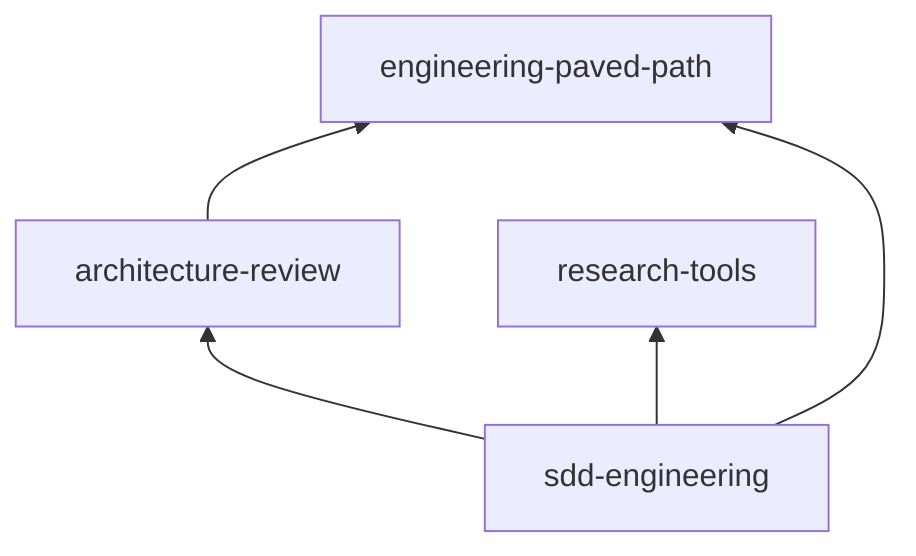

# Releases

Versions, dependency ranges and the release procedure for the plugins in the
`dev-digest-ai` marketplace. Contribution rules (bump on every change, version
only in `plugin.json`, CHANGELOG entry) are in [CONTRIBUTING.md](../CONTRIBUTING.md).

## Current versions

| Plugin | Version | Tag | Depends on |
|---|---|---|---|
| engineering-paved-path | 1.1.0 | `engineering-paved-path--v1.1.0` | — |
| research-tools | 1.1.0 | `research-tools--v1.1.0` | — |
| architecture-review | 1.1.0 | `architecture-review--v1.1.0` | engineering-paved-path (compat `^1.0.0`) |
| sdd-engineering | 1.2.0 | `sdd-engineering--v1.2.0` | engineering-paved-path, research-tools, architecture-review (compat `^1.0.0` each) |



## How versions resolve

- **The version lives in `plugin.json` only.** It must be SemVer; `check_marketplace.py` enforces it.
- **Dependencies are declared in the dependent's `plugin.json` by name only**, so Claude Code installs the copy this marketplace serves rather than resolving a range against git tags. The range a dependent was tested against lives in `metadata.compat` as `^X.Y.Z`; Claude Code does not read it, and `check_marketplace.py` checks that each dependency is in the catalog and that its current version satisfies the range. See [docs/specs/release-channels.md](specs/release-channels.md) for why.
- **Tags** are `<plugin>--v<version>` on this repository. Dependencies inside this marketplace no longer resolve against them; they record releases, and serve other marketplaces that depend on these plugins with a range.
- **What is a breaking change.** Removing or renaming a skill or agent, changing an agent's required inputs, report headings other components parse (`Verdict:`, `Result:`, `Status:`, `## Insight candidates`, `## Handoff to …`), or a skill's § numbering that agents cite. A breaking change in a dependency is a new major, and every dependent widens its `metadata.compat` range in the same pull request; `check_marketplace.py` fails the pull request otherwise.

## Release order

Dependencies first, dependents last:

1. `engineering-paved-path`, `research-tools`
2. `architecture-review`
3. `sdd-engineering`

The **Tag plugin releases** workflow (`.github/workflows/release.yml`) runs after every merge to `main`. It sorts the plugins by their `dependencies` and runs `claude plugin tag --push` for each version that has no tag yet, so a dependency is always tagged before its dependents. If one tag fails, the loop stops there, and no dependent is tagged without its dependency.

When several plugins change in one pull request, one merge tags them all in the right order. When a dependent needs a new version of a dependency, release the dependency first (its own pull request), then the dependent.

## Release checklist

Before merging a release pull request:

1. Bump `version` and add a `## [x.y.z]` CHANGELOG entry for every changed plugin.
2. Run the checks from [CONTRIBUTING.md](../CONTRIBUTING.md#checks-to-run-before-pushing), including `claude plugin validate --strict` for the marketplace and every plugin.
3. Run the offline self-tests:
   ```bash
   bash plugins/sdd-engineering/scripts/test-spec-lint.sh
   bash plugins/sdd-engineering/skills/sdd-run/scripts/save-report.sh --self-test
   node --test plugins/sdd-engineering/skills/workflow-retro/scripts/retro.test.mjs
   ```
4. Load the four plugins together and check that the namespaced names resolve: `/sdd-engineering:sdd-run` is offered, and `/agents` lists `research-tools:researcher` and `architecture-review:architecture-reviewer`:
   ```bash
   claude --plugin-dir ./plugins/engineering-paved-path --plugin-dir ./plugins/research-tools \
          --plugin-dir ./plugins/architecture-review --plugin-dir ./plugins/sdd-engineering
   ```
5. Run the evals. They make paid model calls and need you to trust the directory, so they run by hand, not in CI:
   ```bash
   claude plugin eval plugins/engineering-paved-path --no-publish   # plugins without dependencies
   claude plugin eval plugins/research-tools --no-publish
   claude plugin eval . --allow-tools Write Edit "Bash(bash *)" "Bash(git *)" --no-publish   # repo-level suite: architecture-review + sdd-engineering, all four plugins loaded
   ```
   The eval runner loads only the plugin under test, and a plugin whose `dependencies` are missing is disabled, so cases for plugins with dependencies live in the repository-level `evals/` and list every plugin they need in `plugins:`.
6. Fill in the release evidence row below (the commit SHA after the merge).

## Updating and rolling back

- **Users** get an update only when the version changes. Auto-update is off by default for third-party marketplaces: `claude plugin marketplace update dev-digest-ai` refreshes the catalog, then `claude plugin update <plugin>@dev-digest-ai`. Update the marketplace first, then the plugin.
- **Rollback** never moves or deletes a tag. Revert the change on `main`, bump the patch version (for example `1.1.0` → `1.1.1` carrying the `1.0.x` content), and let the workflow tag it. Dependents with `^1.0.0` pick it up as the highest matching tag.

## Release evidence

One row per released version. Fill in the commit and eval columns when the release is merged and tagged.

**1.0.0 install check (2026-10-20):** in a clean config, `claude plugin marketplace add kosyakovr/dev-digest-ai-marketplace` then `claude plugin install sdd-engineering@dev-digest-ai` installed and enabled all four plugins (`+ 3 dependencies`, no prompt), the dependencies at their `--v1.0.0` tags. The **Tag plugin releases** run tagged them in dependency order: engineering-paved-path, architecture-review, research-tools, sdd-engineering.

| Date | Plugin | Version | Tag | Commit | Validation | Evals (judge: sonnet, 3 runs, with vs. without plugin) |
|---|---|---|---|---|---|---|
| 2026-10-20 | engineering-paved-path | 1.0.0 | `engineering-paved-path--v1.0.0` | `90ae6ec` | validate --strict ✓, policy checks ✓ | 2/2 cases, 6/6 runs (Δ 0: base model already knows these rules; skill loads by namespace 3/3) |
| 2026-10-20 | research-tools | 1.0.0 | `research-tools--v1.0.0` | `90ae6ec` | validate --strict ✓, policy checks ✓ | 1/1 case, 3/3 runs, Δ +1.00 |
| 2026-10-20 | architecture-review | 1.0.0 | `architecture-review--v1.0.0` | `90ae6ec` | validate --strict ✓, policy checks ✓ | 1/1 case (repo-level), 3/3 runs, Δ +0.50 |
| 2026-10-20 | sdd-engineering | 1.0.0 | `sdd-engineering--v1.0.0` | `90ae6ec` | validate --strict ✓, policy checks ✓, self-tests ✓, four-plugin `--plugin-dir` load: 7 agents + 15 skills resolve by namespace ✓ | 3/3 cases (repo-level), 9/9 runs; Δ +0.56 spec-creator, +1.00 planner, 0 for the negative sdd-run case |
| 2026-10-21 | sdd-engineering | 1.1.0 | `sdd-engineering--v1.1.0` | `8c4f57b` | validate --strict ✓, policy checks ✓, spec-lint self-test 13/13 ✓ | new case `spec-creator-keeps-every-story-covered`: 3/3 runs, Δ +0.73; other cases not re-run |

## History

| Plugin | Version | Notes |
|---|---|---|
| review-pack | 0.1.0 | Stub, tagged `review-pack--v0.1.0`. Renamed to `architecture-review` (mapped in `renames`); the rename's 0.2.0 was never released and 1.0.0 replaces it. |
| engineering-paved-path, research-tools, sdd-engineering | 0.1.0 | Stubs, replaced by 1.0.0. |
