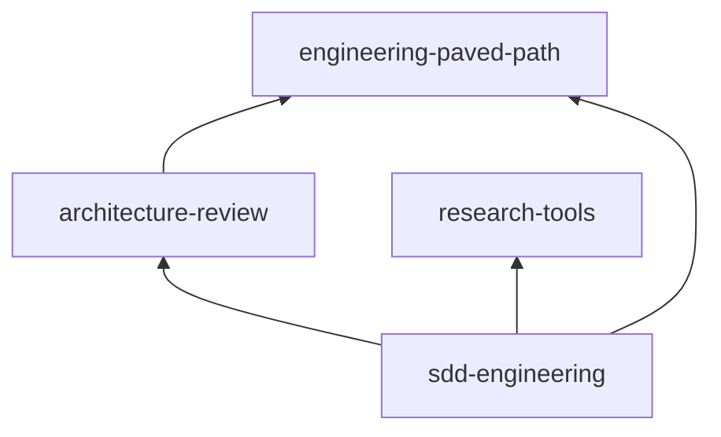

# Releases

Versions, dependency ranges and the release procedure for the plugins in the
`dev-digest-ai` marketplace. Contribution rules (bump on every change, version
only in `plugin.json`, CHANGELOG entry) are in [CONTRIBUTING.md](../CONTRIBUTING.md).

## Current versions

| Plugin | Version | Tag | Depends on |
|---|---|---|---|
| engineering-paved-path | 1.0.0 | `engineering-paved-path--v1.0.0` | — |
| research-tools | 1.0.0 | `research-tools--v1.0.0` | — |
| architecture-review | 1.0.0 | `architecture-review--v1.0.0` | engineering-paved-path `^1.0.0` |
| sdd-engineering | 1.0.0 | `sdd-engineering--v1.0.0` | engineering-paved-path `^1.0.0`, research-tools `^1.0.0`, architecture-review `^1.0.0` |



## How versions resolve

- **The version lives in `plugin.json` only.** It must be SemVer; `check_marketplace.py` enforces it.
- **Dependencies are declared in the dependent's `plugin.json`** as `{ "name": "<plugin>", "version": "<range>" }`, with bare names from this marketplace. Ranges use node-semver syntax; this marketplace uses `^MAJOR.0.0`.
- **Claude Code installs a dependency at the highest git tag that satisfies the range.** Tags are `<plugin>--v<version>` on this repository, so a version that is not tagged cannot satisfy a dependent. `check_marketplace.py` checks that every bare dependency exists here and that each `^` range accepts the dependency's current version.
- **What is a breaking change.** Removing or renaming a skill or agent, changing an agent's required inputs, report headings other components parse (`Verdict:`, `Result:`, `Status:`, `## Insight candidates`, `## Handoff to …`), or a skill's § numbering that agents cite. A breaking change in a dependency is a new major, and every dependent widens its range in the same pull request.

## Release order

Dependencies first, dependents last:

1. `engineering-paved-path`, `research-tools`
2. `architecture-review`
3. `sdd-engineering`

The **Tag plugin releases** workflow (`.github/workflows/release.yml`) runs after every merge to `main`. It sorts the plugins by their `dependencies` and runs `claude plugin tag --push` for each version that has no tag yet, so a dependency is always tagged before its dependents. If one tag fails, the loop stops there, and no dependent is tagged without its dependency.

When several plugins change in one pull request, one merge tags them all in the right order. When a dependent needs a new version of a dependency, release the dependency first (its own pull request), then the dependent.

## Release checklist

Before merging a release pull request:

1. Bump `version` and add a `## [x.y.z]` CHANGELOG entry for every changed plugin.
2. Run the checks from [CONTRIBUTING.md](../CONTRIBUTING.md#checks-to-run-before-pushing), including `claude plugin validate --strict` for the marketplace and every plugin.
3. Run the offline self-tests:
   ```bash
   bash plugins/sdd-engineering/scripts/test-spec-lint.sh
   bash plugins/sdd-engineering/skills/sdd-run/scripts/save-report.sh --self-test
   node --test plugins/sdd-engineering/skills/workflow-retro/scripts/retro.test.mjs
   ```
4. Load the four plugins together and check that the namespaced names resolve: `/sdd-engineering:sdd-run` is offered, and `/agents` lists `research-tools:researcher` and `architecture-review:architecture-reviewer`:
   ```bash
   claude --plugin-dir ./plugins/engineering-paved-path --plugin-dir ./plugins/research-tools \
          --plugin-dir ./plugins/architecture-review --plugin-dir ./plugins/sdd-engineering
   ```
5. Run the evals of every changed plugin. They make paid model calls and need you to trust the plugin directory, so they run by hand, not in CI:
   ```bash
   claude plugin eval plugins/<name> --no-publish
   ```
6. Fill in the release evidence row below (the commit SHA after the merge).

## Updating and rolling back

- **Users** get an update only when the version changes. Auto-update is off by default for third-party marketplaces: `claude plugin marketplace update dev-digest-ai` refreshes the catalog, then `claude plugin update <plugin>@dev-digest-ai`. Update the marketplace first, then the plugin.
- **Rollback** never moves or deletes a tag. Revert the change on `main`, bump the patch version (for example `1.1.0` → `1.1.1` carrying the `1.0.x` content), and let the workflow tag it. Dependents with `^1.0.0` pick it up as the highest matching tag.

## Release evidence

One row per released version. Fill in the commit and eval columns when the release is merged and tagged.

| Date | Plugin | Version | Tag | Commit | Validation | Evals |
|---|---|---|---|---|---|---|
| 2026-10-20 | engineering-paved-path | 1.0.0 | `engineering-paved-path--v1.0.0` | _pending merge_ | validate --strict ✓, policy checks ✓ | not run yet |
| 2026-10-20 | research-tools | 1.0.0 | `research-tools--v1.0.0` | _pending merge_ | validate --strict ✓, policy checks ✓ | not run yet |
| 2026-10-20 | architecture-review | 1.0.0 | `architecture-review--v1.0.0` | _pending merge_ | validate --strict ✓, policy checks ✓ | not run yet |
| 2026-10-20 | sdd-engineering | 1.0.0 | `sdd-engineering--v1.0.0` | _pending merge_ | validate --strict ✓, policy checks ✓, self-tests ✓, four-plugin `--plugin-dir` load: 7 agents + 15 skills resolve by namespace ✓ | not run yet |

## History

| Plugin | Version | Notes |
|---|---|---|
| review-pack | 0.1.0 | Stub, tagged `review-pack--v0.1.0`. Renamed to `architecture-review` (mapped in `renames`); the rename's 0.2.0 was never released and 1.0.0 replaces it. |
| engineering-paved-path, research-tools, sdd-engineering | 0.1.0 | Stubs, replaced by 1.0.0. |
