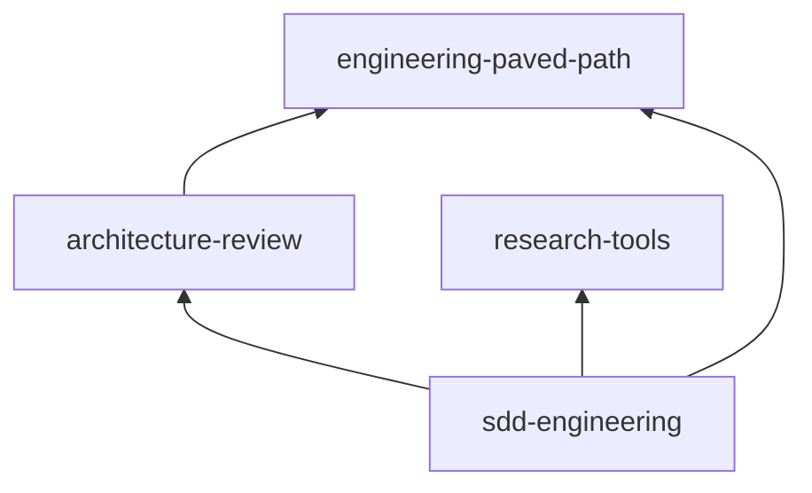

# Releases

Release channels, versions and the promotion procedure for the plugins in this
marketplace. The design and its reasons are in
[docs/specs/release-channels.md](specs/release-channels.md). Contribution rules
(bump on every change, version only in `plugin.json`, CHANGELOG entry) are in
[CONTRIBUTING.md](../CONTRIBUTING.md).

## Channels

| | stable | latest |
|---|---|---|
| Marketplace | `dev-digest-ai` | `dev-digest-ai-latest` |
| Add it with | `claude plugin marketplace add kosyakovr/dev-digest-ai-marketplace` | `claude plugin marketplace add kosyakovr/dev-digest-ai-marketplace#latest` |
| Serves | each plugin at the commit its entry pins, only after a promotion | every plugin under `plugins/` as soon as it is merged |
| Catalog | `.claude-plugin/marketplace.json` on `main`, changed only by promotion PRs | branch `latest`, generated by CI after every merge; never edit it |

Register one channel only. With both, every plugin installs twice, once per marketplace. To switch, remove one marketplace (`claude plugin marketplace remove <name>`) and add the other.

## Current versions

<!-- versions:start (generated by scripts/generate_catalog.py, do not edit) -->
| Plugin | Stable | Latest | Depends on (compat range) |
|---|---|---|---|
| architecture-review | 1.1.0 | 1.1.0 | engineering-paved-path `^1.0.0` |
| engineering-paved-path | 1.1.0 | 1.1.0 | — |
| research-tools | 1.1.0 | 1.1.0 | — |
| sdd-engineering | 1.2.0 | 1.2.0 | engineering-paved-path `^1.0.0`, research-tools `^1.0.0`, architecture-review `^1.0.0` |
<!-- versions:end -->



## How versions resolve

- **The version lives in `plugin.json` only**, as plain `X.Y.Z`. Pre-release suffixes are rejected: the latest channel is where unreleased versions go. `check_marketplace.py` enforces both.
- **Dependencies are declared by name only**, so Claude Code installs the copy the user's own channel serves, never one picked by git tags or from the other channel. The range a dependent was tested against lives in `metadata.compat` as `^X.Y.Z`. Claude Code does not read it; `check_marketplace.py` checks, for each channel, that every dependency is in that channel and that its version satisfies the range.
- **Tags** `<plugin>--v<version>` mark stable releases. CI creates one at the pinned commit after each promotion. Nothing inside this marketplace resolves against tags; other marketplaces that depend on these plugins with a range do.
- **What is a breaking change.** Removing or renaming a skill or agent, changing an agent's required inputs, report headings other components parse (`Verdict:`, `Result:`, `Status:`, `## Insight candidates`, `## Handoff to …`), or a skill's § numbering that agents cite. A breaking change in a dependency is a new major; every dependent widens its `metadata.compat` range in the same pull request, and is promoted together with it.

## Merging to main (latest)

1. Bump `version` and add a `## [x.y.z]` CHANGELOG entry for every changed plugin. Say in the entry when the version adds a dependency.
2. Run the checks from [CONTRIBUTING.md](../CONTRIBUTING.md#checks-to-run-before-pushing). CI runs them too, including a dry run of the latest catalog.
3. After the merge, the **Release channels** workflow regenerates branch `latest`. No paid evals run at this point.

## Promoting to stable

One plugin per pull request. The PR changes only `.claude-plugin/marketplace.json` and the version tables `generate_catalog.py` writes; `check_promotion.py` fails anything else.

1. Choose the commit on `main` that holds the version to promote, and pin it:
   ```bash
   python3 scripts/pin_stable.py <commit> <plugin>
   python3 scripts/generate_catalog.py
   python3 scripts/check_marketplace.py   # every stable dependency is in stable, at a compatible version
   ```
   A major version of a dependency fails this check until its dependents are pinned in the same PR at versions that accept it.
2. Run the paid evals for that plugin only, at the pinned commit:
   ```bash
   git worktree add ../promote <commit> && cd ../promote
   claude plugin eval plugins/<plugin> --no-publish                     # a plugin without dependencies
   claude plugin eval . --tag <plugin> --allow-tools Write Edit "Bash(bash *)" "Bash(git *)" --no-publish   # a plugin with dependencies
   ```
   Repository-level cases carry the name of the plugin they test in `tags`; `check_marketplace.py` enforces it.
3. Open the PR titled `Promote <plugin> <version> to stable`. Put the eval scores in the description. When the version adds a dependency, tell users to run `/reload-plugins` after updating: `claude plugin update` does not install new dependencies, and the plugin fails to load until they arrive.
4. After the merge, the workflow tags `<plugin>--v<version>` at the pinned commit. Fill in the release evidence row below.

## Rolling back

Open a PR that moves the plugin's pin back to an earlier commit with `pin_stable.py`, or removes a newly added entry, and put "rollback" in its title; `check_promotion.py` refuses either without it. Tags are never moved or deleted.

## Updating

Users get an update only when the version changes. Auto-update is off by default for third-party marketplaces: `claude plugin marketplace update <marketplace>` refreshes the catalog, then `claude plugin update <plugin>@<marketplace>`. A version that adds a dependency also needs `/reload-plugins` in a session, or marketplace auto-update, to install it.

## Release evidence

One row per released version. Fill in the commit and eval columns when the release is merged and tagged.

**1.0.0 install check (2026-10-20):** in a clean config, `claude plugin marketplace add kosyakovr/dev-digest-ai-marketplace` then `claude plugin install sdd-engineering@dev-digest-ai` installed and enabled all four plugins (`+ 3 dependencies`, no prompt), the dependencies at their `--v1.0.0` tags. The **Tag plugin releases** run tagged them in dependency order: engineering-paved-path, architecture-review, research-tools, sdd-engineering.

| Date | Plugin | Version | Tag | Commit | Validation | Evals (judge: sonnet, 3 runs, with vs. without plugin) |
|---|---|---|---|---|---|---|
| 2026-10-20 | engineering-paved-path | 1.0.0 | `engineering-paved-path--v1.0.0` | `90ae6ec` | validate --strict ✓, policy checks ✓ | 2/2 cases, 6/6 runs (Δ 0: base model already knows these rules; skill loads by namespace 3/3) |
| 2026-10-20 | research-tools | 1.0.0 | `research-tools--v1.0.0` | `90ae6ec` | validate --strict ✓, policy checks ✓ | 1/1 case, 3/3 runs, Δ +1.00 |
| 2026-10-20 | architecture-review | 1.0.0 | `architecture-review--v1.0.0` | `90ae6ec` | validate --strict ✓, policy checks ✓ | 1/1 case (repo-level), 3/3 runs, Δ +0.50 |
| 2026-10-20 | sdd-engineering | 1.0.0 | `sdd-engineering--v1.0.0` | `90ae6ec` | validate --strict ✓, policy checks ✓, self-tests ✓, four-plugin `--plugin-dir` load: 7 agents + 15 skills resolve by namespace ✓ | 3/3 cases (repo-level), 9/9 runs; Δ +0.56 spec-creator, +1.00 planner, 0 for the negative sdd-run case |
| 2026-10-21 | sdd-engineering | 1.1.0 | `sdd-engineering--v1.1.0` | `8c4f57b` | validate --strict ✓, policy checks ✓, spec-lint self-test 13/13 ✓ | new case `spec-creator-keeps-every-story-covered`: 3/3 runs, Δ +0.73; other cases not re-run |

## History

| Plugin | Version | Notes |
|---|---|---|
| review-pack | 0.1.0 | Stub, tagged `review-pack--v0.1.0`. Renamed to `architecture-review` (mapped in `renames`); the rename's 0.2.0 was never released and 1.0.0 replaces it. |
| engineering-paved-path, research-tools, sdd-engineering | 0.1.0 | Stubs, replaced by 1.0.0. |
