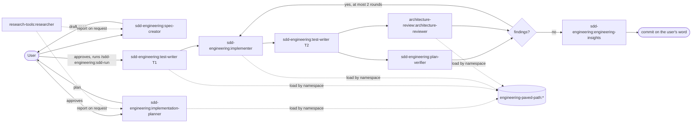

# Spec: Plugin suite 1.0

- **Status:** approved (open questions answered by the owner, 2026-10-20)
- **Owner:** Ruslan Kosiakov
- **Last updated:** 2026-10-20
- **Sources:** the [kosyakovr/dev-digest](https://github.com/kosyakovr/dev-digest) repository at `64adb39` (`.claude/agents`, `.claude/skills`), the L08 lab slides (taken as direction, not instructions), and the Claude Code plugin docs ([manifest](https://code.claude.com/docs/en/plugins/manifest-reference.md), [dependencies](https://code.claude.com/docs/en/plugins/dependencies.md), [components](https://code.claude.com/docs/en/plugins/components.md), [evals](https://code.claude.com/docs/en/plugin-evals.md)).

## Problem

The four plugins in this marketplace are stubs. The working agents and skills live in the DevDigest repository and only work there: they read `server/src/…` and `specs/_template.md`, call `scripts/checks.sh`, and load skills from `.claude/skills/<name>/SKILL.md`. They also rely on frontmatter hooks and agents that are not part of this marketplace. Another team cannot install them.

## Goal

Ship the four plugins at **1.0.0** as one spec-driven development (SDD) harness. A user installs `sdd-engineering` in any repository, the installer adds its three dependencies, and the chain spec → plan → implement → review → verify runs without DevDigest-specific paths.

## Non-goals

- The DevDigest agents `security-reviewer`, `doc-writer` and `brainstormer`, the `pr-self-review` skill and its push gate. The flow below works without them: docs are updated by the implementer from the plan's "Docs to update" list, and security rules reach the code through `engineering-paved-path:security`.
- Hook-based scope guards (`agent-scope-guard.sh`, `implementer-guard.sh`). Plugin agents ignore the `hooks`, `permissionMode` and `mcpServers` frontmatter fields, and a plugin-wide hook would run on every tool call in every session (D4).
- The DevDigest MCP server (`mcp__devdigest__*`).
- The 1.1.0 update round from the slides. This spec covers 1.0.0 only.
- Separate `PLUGIN-GUIDELINES.md` and `SECURITY.md` files. `CONTRIBUTING.md` already holds the authoring rules, and each README gets a "What runs on your machine" section.

## Plugins at 1.0.0

All existing stub components are deleted: `code-review`, `code-reviewer`, `write-spec`, `spec-to-plan`, `spec-reviewer`, `scaffold-service`, `write-adr`, `paved-path-auditor`, `research-topic`, `compare-options` and `source-checker`.

| Plugin | Components | Depends on |
|---|---|---|
| `engineering-paved-path` | Skills: `react-best-practices`, `react-testing-library`, `next-best-practices` (written anew from the official Next.js docs, Q2), `fastify-best-practices`, `onion-architecture`, `frontend-ui-architecture`, `drizzle-orm-patterns`, `postgresql-table-design`, `zod`, `typescript-expert`, `security`, `mermaid-diagram`, plus `skill-routing` (D2) | none |
| `research-tools` | Agent: `researcher` (read-only) | none |
| `architecture-review` | Agent: `architecture-reviewer` (read-only) | `engineering-paved-path ^1.0.0` |
| `sdd-engineering` | Agents: `spec-creator`, `implementation-planner`, `test-writer` (Q1), `implementer`, `plan-verifier`. Skills: `sdd-run` (user-invoked only), `workflow-retro`, `engineering-insights` | `engineering-paved-path ^1.0.0`, `research-tools ^1.0.0`, `architecture-review ^1.0.0` |

Plugin-level files in `sdd-engineering`, referenced through `${CLAUDE_PLUGIN_ROOT}`:

- `templates/spec-template.md` (from DevDigest `specs/_template.md`)
- `scripts/spec-lint.sh`
- `scripts/change-set.sh`
- `reference/sdd-files.md` (spec and plan status lifecycle, plan header, `**Approved:**` line, Amendments, Run log; from DevDigest `specs/README.md` and `docs/plans/README.md`)

Skill-level scripts, referenced through `${CLAUDE_SKILL_DIR}`:

- `sdd-run/scripts/save-report.sh`
- `workflow-retro/scripts/{retro.mjs,shell.mjs,retro.test.mjs}`
- `typescript-expert/scripts/ts_diagnostic.py`
- `engineering-insights/templates/INSIGHTS.md`

## How the flow works

`/sdd-engineering:workflow-retro` runs after a finished run.

## Requirements

### Generalisation

| ID | Requirement | Verified by |
|---|---|---|
| R1 | No component names DevDigest, its packages or its lessons. Provenance in `CHANGELOG.md` and `THIRD_PARTY_NOTICES.md` may name the source project. | `grep -rniE 'devdigest\|reviewer-core\|mcp-server\|server/src\|client/src\|lessons?/l0' plugins/*/{agents,skills,scripts,templates,reference,evals}` returns nothing |
| R2 | **Explicit inputs.** Every agent starts with an `## Inputs` table that lists each input, whether it is required, and its default. A missing required input returns `NEEDS CLARIFICATION` (or `BLOCKED` for the implementer). No agent searches for a fixed repository layout. The inputs are listed in the table below. | inspection of every agent |
| R3 | **Namespaced dependencies.** References between components use `plugin:name`, for example `engineering-paved-path:onion-architecture`, `architecture-review:architecture-reviewer` or `research-tools:researcher`. Skills are loaded with the Skill tool, not read from a path. | `grep -rnE '\.claude/(skills\|agents\|hooks)' plugins/` returns nothing |
| R4 | Plugin-level files are referenced as `"${CLAUDE_PLUGIN_ROOT}/…"`. Scripts inside a skill are referenced as `"${CLAUDE_SKILL_DIR}/scripts/…"` and called through their interpreter. | grep: no bare `scripts/…` or `.claude/` invocation |
| R5 | **No credentials in manifests.** No plugin needs a secret at 1.0.0, so there is no `userConfig`, no `.mcp.json` and no `env`. `check_marketplace.py` fails a manifest that contains token-shaped values or literal `env` secrets. If a secret is ever needed, it goes in `userConfig` with `sensitive: true`. | the new check, plus a test fixture |
| R6 | **One owner per instruction.** An agent cites a skill rule as `skill §n` and never restates it. Each topic has one owner, listed in the owners table below. | review against that table |
| R7 | Agent frontmatter keeps only the fields that plugin agents support. `hooks`, `permissionMode` and `mcpServers` are removed. Read-only agents have no `Write`/`Edit`. Agents that apply paved-path rules get `Skill`, and their prompt limits it to `engineering-paved-path:*`. | inspection; `claude plugin validate --strict` |
| R8 | Without the hook guards, the forbidden actions become `disallowedTools` where a tool can express them. The rest are hard rules in the prompt: no commit or push, no lock files or migrations, and no edits outside the plan. The README states that these rules are not enforced by a sandbox. | inspection |

**Inputs** (R2). `sdd-run` resolves each input once, in this order: command argument, then an `## SDD` section in the project's `CLAUDE.md` or `AGENTS.md`, then the default, then one question to the user. It prints the values on its run card, records them in the plan's Run log so a resumed run reuses them, and passes them to every agent in the delegation prompt.

| Input | Used by | Default |
|---|---|---|
| `spec_path` / `spec_dir` | spec-creator, planner, test-writer, verifier, sdd-run | `docs/specs/` |
| `plan_path` | planner (output), implementer, verifier, sdd-run | `docs/plans/<spec file name>` |
| `spec_template` | spec-creator | `${CLAUDE_PLUGIN_ROOT}/templates/spec-template.md` |
| `check_commands` | test-writer, implementer, verifier | The plan's Test plan. The planner derives it from CI config, package scripts and the README, and never invents it. |
| `protected_paths` | test-writer, implementer, verifier | Lock files and migration directories, plus whatever the project's instruction files list |
| `architecture_docs` | architecture-reviewer, planner | Discovered: `ARCHITECTURE.md`, `docs/architecture/**`, `docs/adr/**`, plus the architecture sections of `CLAUDE.md` and `AGENTS.md`. The reviewer reports what it read. When none exist, it says so and reviews against paved-path skills only. |
| `change_scope` | architecture-reviewer, verifier | Uncommitted changes against `HEAD`. Otherwise `base..head` or a list of paths. |
| `insights_files` | engineering-insights | The nearest `INSIGHTS.md` above the touched files, else the one at the repository root |
| `run_dir` | sdd-run | `$(git rev-parse --git-dir)/sdd/runs/<plan name>` (outside the tree) |
| `retro_ledger` | workflow-retro | `docs/retros/ledger.md` |

**Owners** (R6).

| Topic | Owner |
|---|---|
| Run orchestration, triage, fix-round limit | `sdd-run` |
| Spec format | `templates/spec-template.md` and `spec-lint.sh` |
| Spec and plan lifecycle (status, approval, amendments, Run log) | `reference/sdd-files.md` |
| Plan format | `implementation-planner` § Output format (the verifier refers to its sections and does not copy them) |
| Which skill governs which file or technology | `engineering-paved-path:skill-routing` |
| Technical rules | the 12 paved-path skills |
| Architecture severity, CRITICAL bar, verdict | `architecture-reviewer` |
| Recording insights | `engineering-insights` (agents only report "Insight candidates") |

### Packaging and release

| ID | Requirement | Verified by |
|---|---|---|
| R9 | `dependencies` are declared in `plugin.json` as `{ "name", "version": "^1.0.0" }`, with bare names from this marketplace. | `claude plugin validate --strict` |
| R10 | All four plugins are at `1.0.0`. Each CHANGELOG has a `## [1.0.0]` entry that lists what was copied and what was generalised. | `check_marketplace.py` |
| R11 | `release.yml` creates tags in dependency order, sorted from the `dependencies` in each `plugin.json`: `engineering-paved-path` before `architecture-review`, and all three before `sdd-engineering`. A failure partway through never leaves a dependent tagged without its dependency. | the ordering script run locally |
| R12 | Each third-party skill keeps its upstream license and attribution in `plugins/engineering-paved-path/THIRD_PARTY_NOTICES.md`, with source repository, path and license. A skill without a redistributable license is not copied (Q2). | inspection |
| R13 | Each plugin has `evals/` cases showing that its skills and agents are reachable by their namespaced names (`tool_used` graders on `Skill` and `Agent`, plus an outcome grader), and that `sdd-run` never fires on its own. Each suite tests only its own plugin, so it does not depend on how the eval runner loads dependencies. Reachability across plugins is checked by loading all four with `--plugin-dir` (R18). The evals run by hand before a release (they make paid model calls), not in CI. | `claude plugin eval plugins/<name>` |

### Documentation and catalog

| ID | Requirement | Verified by |
|---|---|---|
| R14 | The root `README.md` gets a section on how the plugins work together: the dependency graph, the flow diagram above, what to install, the inputs and how to set them in an `## SDD` section, and what runs on your machine (the node and python scripts, and that `workflow-retro` reads local transcripts under `~/.claude/projects`). | review |
| R15 | `docs/RELEASES.md` holds the version table for every plugin, the dependency ranges, the release order, the tag format `<plugin>--v<version>`, the update and rollback steps, and per-release evidence: version, tag, commit SHA and eval result. | review |
| R16 | Each plugin README lists its components, inputs, dependencies and invocation names, such as `/sdd-engineering:sdd-run`. | review |
| R17 | `site/tests/golden-queries.json` drops the stub IDs and has at least one query per new component (23); the stub IDs are gone. Site tests and the build pass. | `npm test && npm run build` |
| R18 | All checks in `CONTRIBUTING.md` pass, and the four plugins load together with `claude --plugin-dir` ×4. In a clean sample repository, `/sdd-engineering:sdd-run` is offered, and the agents of the dependency plugins are listed under their namespaced names. | commands; manual smoke test |

## Decisions

| # | Decision | Why | Rejected alternative |
|---|---|---|---|
| D1 | Agents load paved-path rules with the Skill tool (`engineering-paved-path:<skill>`). | A skill path inside another plugin's cache cannot be known. | Preloading through frontmatter `skills:`: namespaced names are not confirmed in the docs, and it would inject every skill in full. |
| D2 | Add one non-user-invocable `skill-routing` skill to `engineering-paved-path`. It maps file kinds and technologies to skills, replacing DevDigest's `pr-self-review/routing.md`. | The planner and the architecture reviewer both need the map. The plugin that owns the skills should own the map too. | The same table copied into both agents. |
| D3 | Run-specific mechanisms keep their shape but lose fixed paths. Change sets come from the plugin's `change-set.sh`. Checks come from `check_commands`. Reports go to `run_dir`. | This keeps the token-saving design of the original flow. | Dropping snapshots and re-review deltas. |
| D4 | No hooks at 1.0.0 (see R8). | Plugin agents ignore frontmatter hooks. A global `hooks.json` would fire for every tool call of every session, and the docs do not confirm that a hook can tell which agent made the call. | Porting the guards to `hooks/hooks.json`. |
| D5 | `architecture-review` declares its own dependency on `engineering-paved-path`. | It loads those skills itself, even when installed without `sdd-engineering`. | Relying on `sdd-engineering` to pull it in. |

## Resolved questions

1. **Q1. Tests:** `test-writer` is ported into `sdd-engineering`, keeping the T1 (before the implementer) / T2 (after it) split. The implementer writes no tests.
2. **Q2. `next-best-practices`:** written anew from the official Next.js documentation under this repository's MIT license, with the same skill name. Nothing is copied from `vercel-labs/next-skills`.
3. **Q3. Provenance:** `react-best-practices`, `react-testing-library`, `security`, `mermaid-diagram`, `onion-architecture` and `frontend-ui-architecture` were copied from elsewhere. The owner treats them as trusted for redistribution. `THIRD_PARTY_NOTICES.md` records them as "copied via DevDigest, original source not recorded".

The remaining third-party skills are MIT upstream and are attributed in `THIRD_PARTY_NOTICES.md`: `fastify-best-practices` (mcollina/skills), `drizzle-orm-patterns` (giuseppe-trisciuoglio/developer-kit), `postgresql-table-design` (wshobson/agents), `typescript-expert` (sickn33/antigravity-awesome-skills) and `zod` (pproenca/dot-skills).
