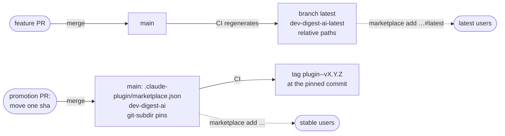

# Spec: Stable and latest release channels

- **Status:** approved (open questions answered and the spec approved by the owner, 2026-10-21)
- **Owner:** Ruslan Kosiakov
- **Last updated:** 2026-10-21
- **Sources:** [docs/ideas/release-channels.md](../ideas/release-channels.md) (research, decisions and checks, 2026-10-21), and the Claude Code plugin docs ([host a marketplace](https://code.claude.com/docs/en/plugins/host-marketplace.md), [marketplace reference](https://code.claude.com/docs/en/plugins/marketplace-reference.md), [dependencies](https://code.claude.com/docs/en/plugins/dependencies.md)).

## Problem

The marketplace has one catalog, and it lists every plugin at the code on `main`. A new plugin or version reaches every user on the next merge, so nothing can be tried by early adopters before everyone gets it.

Claude Code has no channel concept: one marketplace serves one version of each plugin. Two catalogs are the documented way to run channels. But this marketplace's plugins depend on each other with version ranges, and ranges resolve against repository-wide git tags. The checks in the ideas document showed what that does to two channels in one repository: a dependency ignores its channel's catalog and installs at the highest matching tag, and a pre-release installed from latest breaks dependents whose ranges exclude it.

## Goal

Two channels from this repository. **latest** gets every new plugin and every new version as soon as it is merged. **stable** gets a plugin version only when the owner promotes it, one plugin per pull request. Within each channel, a plugin's dependencies always come from that same channel.

## Non-goals

- More than two channels, or channels per user group. An admin can still assign a channel to a group through `extraKnownMarketplaces`; that needs nothing from this repository.
- Migrating existing installs. There are no users yet (decision 4 in the ideas document).
- Pre-release versions (`X.Y.Z-rc.N`). Scheme C makes them unnecessary.
- Claude Code's own range check on users' machines. Bare-name dependencies turn it off; CI checks compatibility instead (R7).
- Rolling back a promotion with anything other than another promotion PR that moves the `sha` back.

## Definitions

- **Channel catalog**: a `marketplace.json` that users add. **stable** is `dev-digest-ai`; **latest** is `dev-digest-ai-latest`.
- **Pin**: a stable entry's `source`: `git-subdir` with `url` = this repository, `path: plugins/<name>`, `ref: main` and a full 40-character `sha`.
- **Promotion**: a pull request that adds a stable entry or moves its `sha` to a later commit on `main`.
- **Compatibility range**: what a plugin accepts of a dependency, written in its `plugin.json` under `metadata.compat`, for example `"metadata": {"compat": {"engineering-paved-path": "^1.0.0"}}`. Claude Code does not read it.

## How it works

| | stable | latest |
|---|---|---|
| Marketplace name | `dev-digest-ai` | `dev-digest-ai-latest` |
| Catalog | `main`, `.claude-plugin/marketplace.json`, edited only by promotion PRs | branch `latest`, generated by CI from `main`, never edited by hand |
| Entries | pins | relative paths to the code on `main` |
| Lists | promoted plugins | every directory under `plugins/` |
| Add command | `claude plugin marketplace add kosyakovr/dev-digest-ai-marketplace` | `claude plugin marketplace add kosyakovr/dev-digest-ai-marketplace#latest` |

## Requirements

### Catalogs

| ID | Requirement | Verified by |
|---|---|---|
| R1 | Every entry in the stable catalog is a pin. Its `name`, `description` and `category` equal the plugin's `name`, `description` and `metadata.category` in `plugin.json` **at the pinned commit**. | `check_marketplace.py` |
| R2 | Every pinned `sha` is a commit reachable from `main` that contains `plugins/<name>/.claude-plugin/plugin.json`. `main` is protected against force pushes and history rewrites, so a pin never becomes unreachable. | `check_marketplace.py` (`git merge-base --is-ancestor`); the branch protection settings |
| R3 | The stable catalog may omit a plugin that exists under `plugins/`. Such a plugin is latest-only. Every plugin in the stable catalog still exists under `plugins/` on `main`. | `check_marketplace.py` |
| R4 | After every push to `main` that changes `plugins/**` or the stable catalog, CI regenerates branch `latest`. It contains the tree of that `main` commit, with a `.claude-plugin/marketplace.json` named `dev-digest-ai-latest` that lists every plugin under `plugins/` with a relative-path source, and its `description` and `category` taken from each `plugin.json`. Nobody edits `latest` by hand. | the workflow run; `git diff main latest --stat` shows only the catalog file |
| R5 | The generated latest catalog passes `check_marketplace.py` and `claude plugin validate --strict` before CI pushes it. A failure leaves `latest` where it was. | the workflow run |

### Dependencies and compatibility

| ID | Requirement | Verified by |
|---|---|---|
| R6 | Every `dependencies` item in a `plugin.json` is a bare plugin name from this marketplace, never an object with `version`, so Claude Code resolves it inside the user's channel. Cross-marketplace dependencies stay out of scope. | `check_marketplace.py` |
| R7 | Every dependency has a compatibility range in `metadata.compat`, in `^X.Y.Z` form, and `metadata.compat` names nothing that `dependencies` does not list. For **each** channel catalog, CI checks that every plugin's dependencies are listed in that same catalog, and that each dependency's version satisfies the dependent's range. Versions and ranges are read at the pinned commit for stable, and at `main` for latest. | `check_marketplace.py`, with a test fixture for a missing dependency, an incompatible version and a range in another form |
| R8 | A promotion that would break R7 for stable fails CI. A major version of a dependency is therefore promoted in the same PR as the dependents that accept it. | R7's check on the promotion PR |
| R9 | `metadata.category` exists in every `plugin.json`. The latest catalog takes `category` from it (R4), and stable entries must match it (R1). | `check_marketplace.py` |

### Versions, tags and promotion

| ID | Requirement | Verified by |
|---|---|---|
| R10 | Versions stay plain SemVer `X.Y.Z`, and every change to a plugin bumps it, as today. A promoted plugin reaches stable with the version string it had in latest. | `check_version_bump.py` (unchanged); `check_marketplace.py` rejects a pre-release suffix |
| R11 | A promotion PR changes only the stable catalog: it adds entries or moves `sha` values to later commits, one plugin per PR. Moving a `sha` backwards is a rollback and needs the word "rollback" in the PR title. | `check_marketplace.py` against the base branch (later commit, or rollback title); review |
| R12 | After a promotion merges, CI creates `<plugin>--v<version>` at the pinned commit for each pin that has no such tag yet. Merges that are not promotions create no tags. Tags no longer drive resolution inside this marketplace; they mark stable releases for history and for other marketplaces that depend on these plugins with a range. | the workflow run; `git tag --points-at <sha>` |
| R13 | A version that adds a dependency says so in its CHANGELOG entry, and the promotion PR description tells users to run `/reload-plugins`: `claude plugin update` does not install new dependencies, and the plugin shows `failed to load` until they arrive (checked 2026-10-21). | review against the promotion checklist (R16) |
| R20 | The paid evals run before a promotion PR merges, only for the promoted plugin, at the commit it pins (Q1). A plugin without dependencies runs its own suite, `claude plugin eval plugins/<name>`. A plugin with dependencies runs the repository-level cases tagged with its name, `claude plugin eval . --tag <name>`, so every repository-level case carries the name of the plugin it tests in `tags`. The scores go into the promotion PR description and the release evidence row. Merges to `main` run no paid evals. | every repository-level case has a plugin-name tag (`check_marketplace.py`); the promotion PR description |

### Documentation and catalog site

| ID | Requirement | Verified by |
|---|---|---|
| R14 | `README.md` explains both channels: the two add commands, what each channel gets, that a user should register only one of them (with both, each plugin installs twice, once per marketplace), and that switching means removing one marketplace and adding the other. The generated plugin table shows each plugin's stable version, or "latest only", and its latest version. | `python3 scripts/generate_catalog.py --check`; review |
| R15 | The catalog site lists every plugin under `plugins/` with its component pages built from the code on `main`, as today, and shows each plugin's stable version (or "latest only") and its latest version. The install page lets the user choose a channel and emits that channel's add command, install commands and team settings. | `cd site && npm test && npm run build`; a test fixture with one stable and one latest-only plugin |
| R16 | `docs/RELEASES.md` replaces its release procedure with the channel model: the promotion checklist (CI green, R7 passes, evals for the promoted plugin per R20, CHANGELOG and `/reload-plugins` note per R13, release evidence row after merge), rollback by moving a `sha` back, and the current-versions table split into stable and latest columns. `CONTRIBUTING.md` drops "a dependency must be released before a dependent needs its new version" and links the promotion procedure. | review |

### Rollout

| ID | Requirement | Verified by |
|---|---|---|
| R17 | **Step 1**, one PR, no channels yet: R6, R7 and R9 land in every `plugin.json` (bare dependencies, `metadata.compat`, `metadata.category`), with a minor version bump for each changed plugin, and the R7 check runs on the single existing catalog. | CI on that PR |
| R18 | **Step 2**, after step 1 merges: the stable catalog switches to pins at step 1's merge commit, and R1–R5, R10–R16 and R20 land. The first `latest` branch is generated by this PR's merge. | CI; the install checks in R19 |
| R19 | After step 2, in a clean `CLAUDE_CONFIG_DIR`: `claude plugin install sdd-engineering@dev-digest-ai` installs it and its three dependencies at the pinned versions; with `#latest`, `sdd-engineering@dev-digest-ai-latest` does the same at the `main` versions. The result is recorded in `docs/RELEASES.md` § Release evidence. | the commands, run by hand |

## Decisions

| # | Decision | Why | Rejected alternative |
|---|---|---|---|
| D1 | Scheme C: bare-name dependencies, a stable catalog of `sha` pins, a generated latest catalog. | A bare name resolves inside the user's own channel; tags no longer take part, so nothing leaks between channels and no pre-release cascade is needed (ideas document § Verified). | A: ranged dependencies with rc versions. B: a second repository for stable. Exact pins `=X.Y.Z`, which still resolve through tags. |
| D2 | Stable keeps the name `dev-digest-ai` and lives on `main` at the default path. | `marketplace add` reads only `.claude-plugin/marketplace.json`, and the default branch is what the plain add command fetches. | Stable on its own branch. |
| D3 | Compatibility ranges live in `plugin.json` under `metadata.compat`. | It passes `validate --strict`, it is versioned with the plugin, and CI can read it at a pinned commit. | A separate file per plugin; an extra key in the dependency object (undocumented); one central file (read at `HEAD` only); a custom top-level key (fails `--strict`). |
| D4 | `category` moves into `plugin.json` as `metadata.category`. | The latest catalog is generated and needs one source for every entry field; `description` already lives in `plugin.json`. | Copying it from the stable entry, which a latest-only plugin does not have. |
| D5 | Promotion is per plugin, one PR each, and only moves `sha` values in the stable catalog. | A small, reviewable gate. The `sha` exists before the PR opens, so stable never points at a tag that does not exist yet. | Promoting the whole repository by merging branches. |

## Resolved questions

1. **Q1. When the paid evals run** (owner, 2026-10-21): before a promotion PR merges, only for the promoted plugin (R20). That is the moment a version reaches stable; latest gets no paid evals.
2. **Q2. What the catalog site shows** (owner, 2026-10-21): one set of pages built from the code on `main`, with each plugin's stable and latest versions marked (R15).
